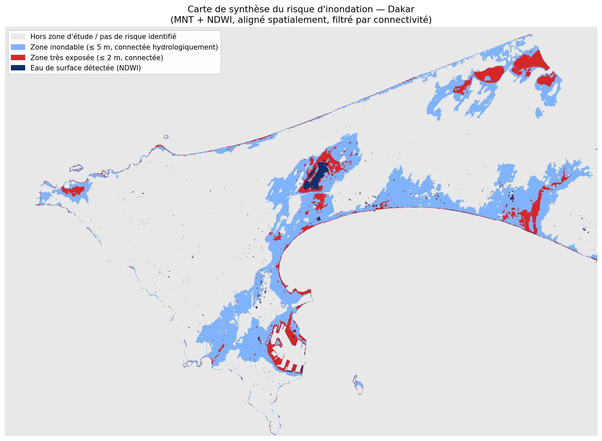

# Analyse spatiale du risque d'inondation — Dakar

Travaux de recherche postdoctoraux : cartographie du risque d'inondation sur
l'agglomération de Dakar à partir d'un Modèle Numérique de Terrain (MNT) et
de bandes spectrales Sentinel-2 (NDWI), avec alignement spatial des couches
et filtrage par connectivité hydrologique.



## Contenu du dépôt

```
.
├── notebooks/
│   ├── analyse_risque_inondation_dakar.ipynb   # notebook principal (version améliorée)
│   └── DR_KEBE_original.ipynb                  # version originale, conservée pour mémoire
├── data/            # données raster (non versionnées, voir "Données" ci-dessous)
├── outputs/          # figures générées par le notebook (PNG)
├── requirements.txt
├── environment.yml
└── README.md
```

## Méthodologie (résumé)

1. **Image en vraies couleurs** : chargement et étirement de contraste par
   percentiles (2-98 %) pour une visualisation lisible.
2. **MNT** : détection de zones basses par seuils altimétriques (≤ 5 m
   « inondable », ≤ 2 m « très exposée »), avec un contrôle qualité qui
   identifie et exclut une valeur de remplissage à 0 m présente dans le MNT
   source (mer / lacune de la mosaïque), afin de ne pas gonfler artificiellement
   les surfaces à risque.
3. **NDWI** : indice de l'eau calculé à partir des bandes Sentinel-2 Verte
   (B3) et Proche Infrarouge (B8).
4. **Carte de synthèse** : le MNT (UTM 28N, 5 m) est **reprojeté et
   ré-échantillonné** sur la grille Sentinel-2 (EPSG:4326, ~10 m) pour une
   véritable fusion pixel à pixel, puis un **filtre de connectivité
   hydrologique** (composantes connexes, `scipy.ndimage.label`) ne retient une
   zone basse que si elle est reliée à de l'eau détectée (NDWI) ou au bord de
   la zone d'étude — ce qui réduit les faux positifs d'un simple seuillage
   altimétrique.

Le notebook documente explicitement ses limites (seuils par défaut à calibrer,
proxy de connectivité simplifié, absence de validation terrain) dans sa
dernière section.

## Données

Les fichiers raster ne sont **pas inclus** dans ce dépôt (jusqu'à 516 Mo,
au-delà des limites de GitHub). Placez-les dans `data/` avec exactement ces
noms avant d'exécuter le notebook :

| Fichier attendu | Description | Résolution | SCR |
|---|---|---|---|
| `DAKAR VRAI COUEUR2.tif` | Image satellite en vraies couleurs (4 bandes) | ~10 m | EPSG:4326 |
| `Dakar_MNE_5m.tif` | Modèle Numérique d'Élévation de Dakar | 5 m | EPSG:32628 (UTM 28N) |
| `b32.tif` | Bande Verte Sentinel-2 (B3) | ~10 m | EPSG:4326 |
| `b82.tif` | Bande Proche Infrarouge Sentinel-2 (B8) | ~10 m | EPSG:4326 |

> À compléter par l'auteur : dates d'acquisition et source exacte de chaque
> fichier (Copernicus Open Access Hub, fournisseur du MNT, etc.) pour la
> traçabilité scientifique.

## Installation

Ce projet a été développé avec l'environnement conda `ANALYSESPATIALE`
(Python 3.12). Pour le recréer :

```bash
conda env create -f environment.yml
conda activate ANALYSESPATIALE
```

Ou, dans un environnement existant :

```bash
pip install -r requirements.txt
```

## Exécution

Ouvrez `notebooks/analyse_risque_inondation_dakar.ipynb` dans VS Code
(extension Jupyter) ou Jupyter Lab, sélectionnez l'interpréteur/noyau
`ANALYSESPATIALE`, et exécutez les cellules dans l'ordre. Les figures sont
automatiquement enregistrées dans `outputs/`.

## Auteur

Dr Kebe — travaux postdoctoraux sur les risques urbains à Dakar.
